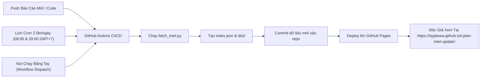

# 🛡️ Cyber Intelligence & Bug Bounty Hub

[](https://github.com/Appleww/cyber-intel-update/actions/workflows/update-intel.yml)
[](https://Appleww.github.io/cyber-intel-update/)
[](https://python.org)
[](LICENSE)

Hệ thống theo dõi, tổng hợp và xuất bản thông tin tình báo an toàn thông tin (Cyber Threat Intelligence) và Bug Bounty tự động hóa hàng ngày. Tích hợp giao diện Dashboard mạng nội bộ lẫn trang tĩnh công khai trên **GitHub Pages**, đi kèm đường ống **CI/CD GitHub Actions** tự động cập nhật dữ liệu 2 lần/ngày.

🌐 **Trang Web Trực Tuyến Công Khai**: [https://Appleww.github.io/cyber-intel-update/](https://Appleww.github.io/cyber-intel-update/)

---

## ⚡ Các Tính Năng Trọng Tâm

1. **Bảng Hướng Dẫn Sử Dụng CVE Thực Chiến (Actionable CVE Cheat Sheets)**:
   - Sàng lọc các lỗ hổng Critical/High, Network vector, Unauthenticated hoặc Low auth, có sẵn Public PoC và Nuclei Template.
   - Trình bày chuẩn 6 phần: *Thông tin chung*, *Root Cause kỹ thuật*, *Môi trường thử nghiệm an toàn (Docker one-liner)*, *Trinh sát (Shodan/FOFA Dorks & Nuclei command)*, *PoC Raw HTTP & cURL script*, *Biện pháp khắc phục*.
   - Đã bao gồm các CVE nóng: **Java4Shell** (`CVE-2026-114938`), **SSHole / ssh2shell** (`CVE-2026-123158`), **Upload2Shell Ghostscript** (`CVE-2026-125396`), **Craft CMS SQLi** (`CVE-2026-123488`), **Laravel TokenGuard Auth Bypass** (`CVE-2026-114509`), **Langflow RCE** (`CVE-2026-105740`), **MLflow File Read** (`CVE-2026-116690`).
   - Nút **1-Click Copy** Docker, cURL, Nuclei thuận tiện cho việc kiểm thử.

2. **Kho Báo Cáo Disclosed Bug Bounty (HackerOne, Bugcrowd, YesWeHack)**:
   - **10 Báo Cáo Mới Nhất Vừa Công Bố**: Lọc chuẩn xác các báo cáo mới nhất trong **Tháng 11/2026** (mã Report ID > 4.1M), viền card phát sáng nổi bật với huy hiệu động `🔥 MỚI NHẤT (T11/2026)`.
   - **Top 50 Báo Cáo Phổ Biến & Tiền Thưởng Cao Nhất (Hall of Fame)**: Xếp hạng các báo cáo danh tiếng dẫn đầu cộng đồng (Shopify SSO Takeover 3,006 upvotes, PayPal Stored XSS $20,000 với 2,687 upvotes, v.v.).

3. **Tin Tức Hacking & AI Security Hàng Ngày**:
   - Tự động quét từ The Hacker News, DarkReading, PortSwigger Daily Swig, Simon Willison AI Research, CISA KEV và ProjectDiscovery Nuclei Release.

4. **Trình Đọc Báo Cáo Hàng Ngày (Markdown Reports Reader)**:
   - Tích hợp sẵn trình đọc markdown ngay trên Dashboard, hiển thị đầy đủ các báo cáo tình báo đã xuất bản theo từng ngày trong thư mục `reports/`.

---

## 🏗️ Luồng Tự Động Hóa CI/CD & Xuất Bản GitHub Pages



---

## 🚀 Hướng Dẫn Sử Dụng Cục Bộ (Local Dashboard)

### 1. Cài đặt môi trường
Yêu cầu Python 3.10 trở lên:
```bash
git clone https://github.com/Appleww/cyber-intel-update.git
cd cyber-intel-update
pip install -r requirements.txt
```
*(Hoặc cài trực tiếp: `pip install aiohttp lxml`)*

### 2. Khởi chạy Web Dashboard
```bash
python web/server.py
```
- Truy cập trên máy tính: [http://localhost:8888](http://localhost:8888) hoặc [http://127.0.0.1:8888](http://127.0.0.1:8888)
- Truy cập từ điện thoại / thiết bị cùng mạng WiFi/LAN: `http://<IP-May-Tinh>:8888` (Server lắng nghe trên `0.0.0.0:8888`).

### 3. Cập nhật dữ liệu thủ công
- Bấm nút **"Cập Nhật Ngay"** trên giao diện web, hoặc chạy dòng lệnh:
```bash
python .agents/skills/daily-security-digest/scripts/fetch_intel.py --output .agents/skills/daily-security-digest/cache/latest_intel.json
```

---

## ⚙️ Hướng Dẫn Cấu Hình GitHub Pages Lần Đầu

Để GitHub Pages tự động xuất bản sau khi push code, bạn chỉ cần thực hiện 2 bước đơn giản trên repository GitHub:

1. **Bật quyền ghi cho GitHub Actions**:
   - Truy cập: `Settings` ➔ `Actions` ➔ `General`.
   - Tại mục **Workflow permissions**, tích chọn: **`Read and write permissions`**.
   - Bấm **Save**.
2. **Kích hoạt GitHub Pages từ GitHub Actions**:
   - Truy cập: `Settings` ➔ `Pages`.
   - Tại mục **Build and deployment / Source**, chọn: **`GitHub Actions`**.
3. **Hoàn tất**: Mỗi khi bạn push dữ liệu mới hoặc đến lịch 08:00/20:00 hàng ngày, GitHub Actions sẽ tự động cập nhật và xuất bản trang web công khai!

---

## 📁 Cấu Trúc Thư Mục

```text
├── .agents/skills/daily-security-digest/  # Skill thu thập & xử lý tình báo
│   ├── cache/latest_intel.json           # Dữ liệu JSON mới nhất
│   ├── cache/cve_guides.json             # 7 Bảng hướng dẫn sử dụng CVE thực chiến
│   └── scripts/fetch_intel.py            # Script cào dữ liệu tự động
├── .github/workflows/
│   └── update-intel.yml                  # Luồng CI/CD tự động cập nhật & deploy Pages
├── reports/                              # Báo cáo an toàn thông tin hàng ngày (.md)
│   ├── index.json                        # Danh mục tự sinh cho static reader
│   ├── 2026-11-23-daily-security-report.md
│   └── 2026-11-24-daily-security-report.md
├── scripts/
│   └── build_pages.py                    # Script đóng gói bản tĩnh cho GitHub Pages
├── web/
│   ├── index.html                        # Giao diện Cyber Dashboard (Hybrid)
│   └── server.py                         # Máy chủ aiohttp nội bộ
├── .gitignore                            # Cấu hình bỏ qua file rác / cache
├── GEMINI.md                             # Nguyên tắc an ninh & tiêu chí CVE tiếp cận
└── README.md                             # Tài liệu hướng dẫn dự án
```

---
*Tuyên bố miễn trừ trách nhiệm: Mọi thông tin, mã PoC và hướng dẫn trong dự án được cung cấp cho mục đích nghiên cứu phòng thủ, nâng cao nhận thức bảo mật và kiểm thử xâm nhập có thẩm quyền.*
